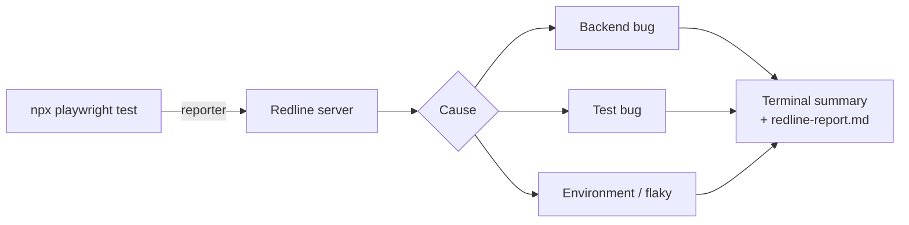

# Playwright API Automation

[](https://github.com/ega-septian/playwright-web-api-automation/actions/workflows/ci.yml)
[](https://github.com/ega-septian/playwright-web-api-automation/actions/workflows/playwright.yml)

**[Latest test report (Allure)](https://ega-septian.github.io/playwright-web-api-automation/)**: published from every run on `main`, with a trend across runs and Redline's cause for each failure.

API test automation for the Toolshop e-commerce API ([Practice Software Testing](https://testsmith-io.github.io/practice-software-testing/)), built with **Playwright**, **TypeScript** and **Zod**. Failed tests are triaged automatically by [Redline](https://github.com/ega-septian/redline), a failure-analysis server I built alongside this suite.

- **Three-layer assertions** on every response: status code, Zod contract, data
- **Positive, negative and boundary tests**, each with a `@TC-` test case ID
- **Every failure explained** by Redline: backend bug, test bug, environment or flaky
- **CI on every pull request**: the API tests run against Toolshop in Docker, plus types, lint, format and test case IDs
- **Public Allure report** from `main`, updated on every merge

## Quick start

Requires Node.js 22.6+ and [Practice Software Testing](https://github.com/testsmith-io/practice-software-testing) sprint 5 running locally with Docker (API at `http://localhost:8091`, `SPRINT=sprint5`, database created with `docker exec pst-laravel-api-1 php artisan migrate:fresh --seed`).

Tests that need a login read these from `.env`. They are the demo accounts from Toolshop's seed data:

```bash
TOOLSHOP_ADMIN_EMAIL=admin@practicesoftwaretesting.com
TOOLSHOP_ADMIN_PASSWORD=welcome01
TOOLSHOP_CUSTOMER_EMAIL=customer@practicesoftwaretesting.com
TOOLSHOP_CUSTOMER_PASSWORD=welcome01
```

```bash
npm install
npm run test:api                         # all Toolshop tests
npx playwright test --grep @TC-BRD-003   # one test case by its ID
npx playwright test --grep "POST /brands" # one endpoint
npx playwright show-report               # Playwright HTML report
npm run test:allure                      # run the tests, then open the Allure report
npm run test:allure TC-BRD-003           # same, for one test case
npm run test:allure TC-BRD-001 TC-BRD-005 # several test cases
npm run test:allure brand                # one spec file (brand.spec.ts)
npm run test:ai TC-BRD-003               # same, with Redline's explanation (REDLINE_AI=1)
npm run test:verify TC-BRD-003           # same, then prove the cause (REDLINE_VERIFY=1)
npm run report:allure:open               # Allure report (after: npm run report:allure)
```

Every run also writes [Allure](https://allurereport.org) results. `npm run report:allure` builds an Allure Report 3 site in `test-results/allure-report` (no Java needed) with suites per endpoint, steps, `@TC-` tags and a trend across runs.

Before pushing:

```bash
npm run format && npm run lint && npx tsc -p . && npm run check:ids
```

## Test coverage

Sprint 5 · Brands (`brand.spec.ts`, 20 tests)

| Endpoint              | Covered                                                                                   |
| --------------------- | ----------------------------------------------------------------------------------------- |
| `POST /brands`        | Create; missing name or slug (422); duplicate slug (409); name length 120/121; empty body |
| `GET /brands`         | List matches schema; new ETag when the list changes                                       |
| `GET /brands/{id}`    | Get by id; unknown id (404); 304 when the ETag matches                                    |
| `PUT /brands/{id}`    | Update; unknown id (404); without name; slug of another brand (409); name length 121      |
| `DELETE /brands/{id}` | Delete as admin, verified by a 404 afterwards; no token (401); customer token (403)       |

Full list with IDs: `npx playwright test --list`. Next: users and login, categories, products, cart and invoices.

## How tests are written

```ts
test("Create brand fails when slug already exists", { tag: "@TC-BRD-008" }, async ({ request }) => {
  const payload = createBrandPayload(); // valid defaults, override only what matters
  // ...create it once, then again:
  expect(response.status()).toBe(409); // 1. status code
  const body = BrandErrorSchema.parse(await response.json()); // 2. contract (Zod)
  expect(body.slug).toContainEqual("A brand already exists with this slug."); // 3. data
});
```

- **Tests create their own data**, so they don't depend on seed data or on each other.
- **Writes are verified with a follow-up read**, not just by the response.
- **One `describe` per endpoint**, so reports and `--grep` follow the API.
- **Logins come from fixtures**: a test asks for `adminToken` or `customerToken` and gets a token that is logged in once per worker (`tests/api/toolshop/fixtures`). Tests that check auth itself, such as a missing token, call the API without it.

## Test case IDs

Redline uses the `@TC-` ID to keep a test's history when it is renamed. The rules:

1. Every test has exactly one `@TC-` tag in capitals, e.g. `@TC-BRD-001` or `@TC-00323`.
2. IDs are unique and never reused.
3. Don't change a test's ID and its name in the same PR.
4. Don't rename the Playwright project (`toolshop`).

Rules 1 and 2 are checked in CI (`npm run check:ids`); 3 and 4 are on the PR checklist.

## Failure triage with Redline



Rules decide first; the AI is only asked when they can't. Each failure in the report comes with a curl command to reproduce it.

The reporter, the fixture and the CLI come from the Redline repo as the `redline-playwright` package (`npm i -D github:ega-septian/redline#<tag>`), pinned in `package.json`.

| Command                                      | What it does                                          |
| -------------------------------------------- | ----------------------------------------------------- |
| `REDLINE_AI=1 npx playwright test`           | Run the tests and explain each failure                |
| `npm run redline:verify`                     | Prove the cause by rerunning and patching in a copy   |
| `npm run redline -- impact schemas/brand.ts` | Tests affected by a file or endpoint, with a `--grep` |
| `npm run redline -- score`                   | How often Redline's guesses turned out right          |
| `npm run redline:bench`                      | Benchmark with planted bugs (below)                   |

Without a Redline server the tests run normally. Set `REDLINE=0` to turn it off, for example in `.env` while writing tests. `REDLINE_AI=1` or `REDLINE_VERIFY=1` on the command line turn it back on for that run; whatever you type on the command line wins over `.env`. If the Redline server has an API key, put the same `REDLINE_API_KEY` in `.env` (and `REDLINE_URL` if it is not on `localhost:8787`).

### ReportPortal (optional)

Results can also go to a local [ReportPortal](https://reportportal.io) with the official agent. It is off by default, so debug runs are not recorded:

```bash
REPORTPORTAL=1 npx playwright test
```

Needs `RP_API_KEY` in `.env` (ReportPortal → Profile → API Keys). Defaults: `RP_ENDPOINT=http://localhost:8585/api/v2`, `RP_PROJECT=superadmin_personal`, `RP_LAUNCH="Toolshop API"`. Each test's `@TC-` tag is sent as its ReportPortal test case ID (history survives renames) and as a `tc` attribute (shown under the test name; filter with **Add filter → Attribute → `tc:TC-BRD-001`**). Skipped tests are not marked "To Investigate".

With Redline on as well, Redline fills in the cause of each failed test that is still "To Investigate" (defect type and a comment with evidence), once the launch is finished:

```bash
REDLINE=1 REPORTPORTAL=1 npx playwright test
```

Both get the same `redline_run` token per run, so Redline finds the right launch. The Redline server needs `REPORTPORTAL_URL` and its own `REPORTPORTAL_API_KEY`.

**Benchmark** (planted bugs, Claude Haiku 5.5): new test 92–96%, test that passed before 96–100%, app upgrade 6/6, shared code 18/18. **No wrong guesses**; unsure cases are reported as "unclear". Scenarios: `--scenario=history|cold|upgrade|kag|rp`.

**Redline vs ReportPortal Auto-Analysis** (`--scenario=rp`, 24 planted bugs, both start with no history and get the right answer after each case, ReportPortal 5.15 with default settings):

|                             | Redline                        | ReportPortal Auto-Analysis              |
| --------------------------- | ------------------------------ | --------------------------------------- |
| Bug seen for the first time | 24/24                          | 2/24, 6 wrong, 16 left "To Investigate" |
| Same bug again              | 24/24 (23 from its own labels) | 21/24, 2 wrong                          |
| Backend bugs, first time    | 9/9                            | 0/9                                     |

Auto-Analysis copies labels from failures with similar logs, so it is good at repeats but labelled backend bugs as test bugs when an earlier test bug had a similar message. Caveats: one run, 24 cases, and the bugs and Redline's rules were built together, while ReportPortal ran untuned. The two are complementary: Auto-Analysis for repeats (free), Redline for new failures.

## Project structure

```
tests/api/toolshop/
├── brand.spec.ts           # tests, one describe per endpoint
├── schemas/                # Zod schemas: expected response shapes
├── data/                   # test data factories
├── types/                  # request payload types
├── fixtures/               # auth tokens, merged with the Redline fixture
└── helper/                 # shared helpers
scripts/                    # benchmark, check-test-ids
redline-bench/              # benchmark specs and planted bugs
```

## Working with AI

AI assistants follow the rulebook in [`AGENTS.md`](AGENTS.md) (Claude Code reads it through `CLAUDE.md`): context, commands, and a Constitution of MUST / SHOULD / WON'T rules taken from how the tests here are written. The AI setup is built in phases (guardrail hooks, skills, a verify-with-Redline workflow, a reviewer); the roadmap is in [`docs/orchestra.md`](docs/orchestra.md).

## CI

`.github/workflows/ci.yml` runs on every push and pull request, without starting any server:

| Step           | Catches                                        |
| -------------- | ---------------------------------------------- |
| Type check     | Wrong types, typos in field names, bad imports |
| Lint           | Missing `await`, unused code, leftover `.only` |
| Format         | Code not formatted with Prettier               |
| All specs load | Specs that fail to load (syntax, imports)      |
| Test case IDs  | Tests without a `@TC-` tag, or a duplicate ID  |
| Security audit | Vulnerable dependencies (warning only)         |

`.github/workflows/playwright.yml` runs the API tests on every pull request and push to `main`: it starts Toolshop (sprint 5, API and database only) with Docker on the runner, seeds the database, then runs `npx playwright test`.

Redline runs in the same job (DozerDB as a service, Redline pinned to a release), so a failure in CI is explained in the job summary and in the Allure report. CI has no AI key: causes come from Redline's rules only, at no cost, and the database is new on every run, so there is no history of earlier runs to compare with.

The Playwright and Allure reports are uploaded as artifacts. On `main`, the Allure report is also published to [GitHub Pages](https://ega-septian.github.io/playwright-web-api-automation/), even when tests fail; the trend history is carried over from the previously published report.
