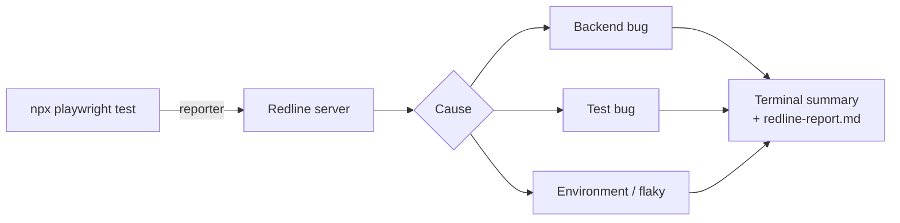

# Playwright API Automation

[](https://github.com/ega-septian/playwright-web-api-automation/actions/workflows/ci.yml)

API test automation for the Toolshop e-commerce API ([Practice Software Testing](https://testsmith-io.github.io/practice-software-testing/)), built with **Playwright**, **TypeScript** and **Zod**. Failed tests are triaged automatically by [Redline](https://github.com/ega-septian/redline), a failure-analysis server I built alongside this suite.

- **Three-layer assertions** on every response: status code, Zod contract, data
- **Positive, negative and boundary tests**, each with a `@TC-` test case ID
- **Every failure explained** by Redline: backend bug, test bug, environment or flaky
- **CI on every pull request**: the API tests run against Toolshop in Docker, plus types, lint, format and test case IDs

## Quick start

Requires Node.js 22.6+ and [Practice Software Testing](https://github.com/testsmith-io/practice-software-testing) running locally with Docker (API at `http://localhost:8091`).

```bash
npm install
npm run test:api                         # all Toolshop tests
npx playwright test --grep @TC-BRD-003   # one test case by its ID
npx playwright test --grep "POST /brands" # one endpoint
npx playwright show-report               # HTML report
```

Before pushing:

```bash
npm run format && npm run lint && npx tsc -p . && npm run check:ids
```

## Test coverage

Sprint 1 · Brands (`brand.spec.ts`, 11 tests)

| Endpoint              | Covered                                                                                   |
| --------------------- | ----------------------------------------------------------------------------------------- |
| `POST /brands`        | Create; missing name or slug (422); duplicate slug (409); name length 120/121; empty body |
| `GET /brands`         | List matches schema                                                                       |
| `GET /brands/{id}`    | Get by id                                                                                 |
| `PUT /brands/{id}`    | Update, verified with a follow-up read                                                    |
| `DELETE /brands/{id}` | Delete, verified by a 404 afterwards                                                      |

Full list with IDs: `npx playwright test --list`. Next: categories, products and images.

## How tests are written

```ts
test("Create brand fails when slug already exists", { tag: "@TC-BRD-008" }, async ({ request }) => {
  const payload = createBrandPayload(); // valid defaults, override only what matters
  // ...create it once, then again:
  expect(response.status()).toBe(409); // 1. status code
  const body = BrandErrorSchema.parse(await response.json()); // 2. contract (Zod)
  expect(body.slug).toContainEqual("A brand already exists with this slug."); // 3. data
});
```

- **Tests create their own data**, so they don't depend on seed data or on each other.
- **Writes are verified with a follow-up read**, not just by the response.
- **One `describe` per endpoint**, so reports and `--grep` follow the API.

## Test case IDs

Redline uses the `@TC-` ID to keep a test's history when it is renamed. The rules:

1. Every test has exactly one `@TC-` tag in capitals, e.g. `@TC-BRD-001` or `@TC-00323`.
2. IDs are unique and never reused.
3. Don't change a test's ID and its name in the same PR.
4. Don't rename the Playwright project (`toolshop`).

Rules 1 and 2 are checked in CI (`npm run check:ids`); 3 and 4 are on the PR checklist.

## Failure triage with Redline



Rules decide first; the AI is only asked when they can't. Each failure in the report comes with a curl command to reproduce it.

| Command                                      | What it does                                          |
| -------------------------------------------- | ----------------------------------------------------- |
| `REDLINE_AI=1 npx playwright test`           | Run the tests and explain each failure                |
| `npm run redline:verify`                     | Prove the cause by rerunning and patching in a copy   |
| `npm run redline -- impact schemas/brand.ts` | Tests affected by a file or endpoint, with a `--grep` |
| `npm run redline -- score`                   | How often Redline's guesses turned out right          |
| `npm run redline:bench`                      | Benchmark with planted bugs (below)                   |

Without a Redline server the tests run normally. Set `REDLINE=0` to turn it off.

**Benchmark** (planted bugs, Claude Haiku 5.5): new test 92–96%, test that passed before 96–100%, app upgrade 6/6, shared code 18/18. **No wrong guesses**; unsure cases are reported as "unclear". Scenarios: `--scenario=history|cold|upgrade|kag`.

## Project structure

```
tests/api/toolshop/
├── brand.spec.ts           # tests, one describe per endpoint
├── schemas/                # Zod schemas: expected response shapes
├── data/                   # test data factories
├── types/                  # request payload types
└── helper/                 # shared helpers
fixtures/redline.ts         # records response shapes and a curl per request
reporters/redline.ts        # sends results to Redline
scripts/                    # Redline CLI, benchmark, check-test-ids
redline-bench/              # benchmark specs and planted bugs
```

## CI

`.github/workflows/ci.yml` runs on every push and pull request, without starting any server:

| Step           | Catches                                        |
| -------------- | ---------------------------------------------- |
| Type check     | Wrong types, typos in field names, bad imports |
| Lint           | Missing `await`, unused code, leftover `.only` |
| Format         | Code not formatted with Prettier               |
| All specs load | Specs that fail to load (syntax, imports)      |
| Test case IDs  | Tests without a `@TC-` tag, or a duplicate ID  |
| Security audit | Vulnerable dependencies (warning only)         |

`.github/workflows/playwright.yml` runs the API tests on every pull request and push to `main`: it starts Toolshop (sprint 1, API and database only) with Docker on the runner, seeds the database, then runs `npx playwright test`. The HTML report is uploaded as an artifact.
