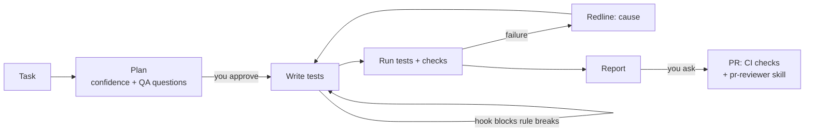

# Playwright API Automation, with an AI agent harness

[](https://github.com/ega-septian/playwright-web-api-automation/actions/workflows/ci.yml)
[](https://github.com/ega-septian/playwright-web-api-automation/actions/workflows/playwright.yml)

**[Latest test report (Allure)](https://ega-septian.github.io/playwright-web-api-automation/)**

API tests for the Toolshop e-commerce API ([Practice Software Testing](https://testsmith-io.github.io/practice-software-testing/)) with **Playwright**, **TypeScript** and **Zod**, built so that an AI agent can add and fix tests safely:

- **The repo carries the rules, not the prompt.** A rulebook, skills and guardrails tell any AI assistant how tests are written here, and block what breaks the rules.
- **The human decides.** The agent plans with a confidence score and waits for approval before it writes anything.
- **Every failure is explained** by [Redline](https://github.com/ega-septian/redline), a failure-triage server I built alongside this suite: backend bug, test bug, environment or flaky.

## How the AI agent works



| Layer           | Where                                                                                      | What it does                                                                                                       |
| --------------- | ------------------------------------------------------------------------------------------ | ------------------------------------------------------------------------------------------------------------------ |
| **Rulebook**    | [`AGENTS.md`](AGENTS.md)                                                                   | Context, commands and a MUST / SHOULD / WON'T Constitution, read by Claude Code, Cursor, Copilot and others        |
| **Skills**      | [`.claude/skills/`](.claude/skills)                                                        | `workflow` (entry point), `api-testing`, `fixtures`, `data-strategy`, `pr-reviewer`: loaded when a task needs them |
| **Guardrails**  | [`guard-spec.mts`](.claude/hooks/guard-spec.mts), [`eslint.config.mjs`](eslint.config.mjs) | Reject a rule break before the file is written (Claude Code hook) and in CI (ESLint)                               |
| **Drift check** | `npm run check:drift`                                                                      | CI fails when a checked rule is in one place only (`AGENTS.md`, hook, ESLint)                                      |
| **Verify**      | Redline                                                                                    | Each failure gets a cause, so the agent fixes the test or reports the bug instead of guessing                      |

Two principles shape the tests the agent writes:

- **The OpenAPI contract is the oracle**, not what the API happens to return. A behaviour the contract doesn't cover is marked as such, and anything that looks wrong goes to the human as a QA question.
- **A test is never weakened to pass.** A mismatch with the contract stays as `test.skip` + `FIXME`; `npm run check:weakening` flags deleted tests, fewer asserts and new skips.

The roadmap and how each phase was proven: [`docs/orchestra.md`](docs/orchestra.md).

## Quick start

Requires Node.js 22.6+. Tests run against the public Toolshop demo (`https://api.practicesoftwaretesting.com`), so nothing else needs to run. Put the demo admin from Toolshop's seed data in `.env`; customers are registered by the tests:

```bash
TOOLSHOP_ADMIN_EMAIL=admin@practicesoftwaretesting.com
TOOLSHOP_ADMIN_PASSWORD=welcome01
```

```bash
npm install
npm run test:api                         # all tests
npx playwright test --grep @TC-USR-010   # one test case by its ID
npm run test:allure brand                # run a spec, then open the Allure report
npm run test:ai TC-BRD-003               # same, with Redline's explanation of failures
npx playwright test --list               # every test with its ID
```

The demo is shared with everyone who practises on it: brands and users the tests create are deleted afterwards, and a test that would affect other people runs only against Docker. To use your own Toolshop, start [Practice Software Testing](https://github.com/testsmith-io/practice-software-testing) sprint 5 in Docker and set `TOOLSHOP_TARGET=local` (API at `http://localhost:8091`).

## How tests are written

```ts
test("Create brand fails when slug already exists", { tag: "@TC-BRD-008" }, async ({ request }) => {
  const payload = createBrandPayload(); // valid defaults, override only what matters
  // ...create it once, then again:
  expect(response.status()).toBe(409); // 1. status code
  const body = BrandErrorSchema.parse(await response.json()); // 2. contract (Zod)
  expect(body.slug).toContainEqual("A brand already exists with this slug."); // 3. data
});
```

- **Tests create their own data** and never depend on seed data or on each other.
- **Writes are verified with a follow-up read**, not only by the response.
- **One `describe` per endpoint**, so reports and `--grep` follow the API.
- **Every test has one unique `@TC-` ID**. Redline uses it to keep a test's history across renames.

The full rules are in [`AGENTS.md`](AGENTS.md). Redline's commands, benchmark and the optional ReportPortal setup: [`docs/redline.md`](docs/redline.md).

## CI

| Workflow                                             | Runs                                                                                                                                                                    |
| ---------------------------------------------------- | ----------------------------------------------------------------------------------------------------------------------------------------------------------------------- |
| [`ci.yml`](.github/workflows/ci.yml)                 | Types, lint, format, specs load, test case IDs, rule drift, security audit (warning only)                                                                               |
| [`playwright.yml`](.github/workflows/playwright.yml) | The API tests against the live demo, with Redline (rules only, no AI cost). Run it by hand with target `local` to test against Toolshop in Docker on the runner instead |

On `main`, the Allure report is published to [GitHub Pages](https://ega-septian.github.io/playwright-web-api-automation/), even when tests fail, with a trend across runs.

## Project structure

```
AGENTS.md                   # rulebook for AI assistants (CLAUDE.md points here)
.claude/skills/             # workflow, api-testing, fixtures, data-strategy, pr-reviewer
.claude/hooks/              # guardrail hook for Claude Code
docs/                       # orchestra roadmap, Redline
tests/api/toolshop/
├── *.spec.ts               # one spec per feature, one describe per endpoint
├── schemas/                # Zod response schemas (strict)
├── data/ · types/          # test data factories, request payload types
├── fixtures/               # auth tokens, target, cleanup, merged with the Redline fixture
└── helper/                 # shared setup
scripts/                    # contract, check-ids, check-drift, check-weakening, benchmark
```
