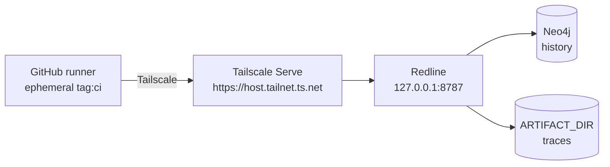

# CI with a persistent Redline over Tailscale

By default `playwright.yml` starts a throwaway Redline and a DozerDB service inside the job. That is
isolated and free, but every run starts with an empty database: a new failure cannot be separated from
an old one, run comparison has nothing to compare, and triage disappears with the runner.

This guide points CI at a persistent Redline running on your laptop and reaches it through Tailscale
Serve. It needs no public URL, no domain and no VPS: only devices in your tailnet can connect.

## How it works



- `tailscale serve` publishes the Redline port inside your tailnet only. `tailscale funnel` would
  make it public; do not use Funnel for this.
- Each workflow run joins the tailnet as an ephemeral node. The Tailscale action logs it out when the
  job ends, and Tailscale removes it.
- The reporter sends every run to `REDLINE_URL`; runs, failure groups, triage and artifacts stay on
  the laptop.
- Nothing is exposed to the public internet.

## 1. Laptop

Requirements: Docker, Tailscale, and a Redline checkout.

```bash
cd ~/Developer/redline
cp -n .env.example .env

# Fill REDLINE_API_KEY in .env with a strong value, for example:
#   REDLINE_API_KEY=<openssl rand -hex 32>
docker compose --profile full up -d --build

tailscale serve --bg 8787
tailscale serve status
curl -s localhost:8787/readyz
```

The Serve output gives the private URL:

```text
https://<machine>.<tailnet>.ts.net
```

Open `https://<machine>.<tailnet>.ts.net/ui/` from a device in your tailnet. The same UI is available
on `http://localhost:8787/ui/`.

Keep the laptop awake while a CI run is in progress. On macOS, `caffeinate -dimsu` while demoing.
If `tailscale serve` is missing, update the Tailscale client.

## 2. Tailscale admin

Enable MagicDNS and HTTPS certificates. New tailnets normally have both on.

Create the `tag:ci` tag and allow it to reach only the Redline port:

```json
{
  "tagOwners": {
    "tag:ci": ["autogroup:admin"]
  },
  "acls": [
    {
      "action": "accept",
      "src": ["tag:ci"],
      "dst": ["<machine>:443"]
    }
  ]
}
```

Replace `<machine>` with the laptop's Tailscale machine name. Port 443 is correct because Tailscale
Serve terminates TLS there and forwards to `127.0.0.1:8787`. Do not grant the CI tag access to every
port or every device.

Create an OAuth client under **Trust credentials → OAuth** with:

- `Devices: Core` — write
- `Auth Keys` — write
- tag `tag:ci`

Copy the client ID and secret. The GitHub Action uses them to create one ephemeral node per run.
An ephemeral, reusable auth key also works, but it has to be rotated; OAuth is recommended.

## 3. GitHub repository configuration

Set one repository **variable** and three secrets:

```bash
gh variable set REDLINE_TAILNET_HOST --body "<machine>.<tailnet>.ts.net"
gh secret set TS_OAUTH_CLIENT_ID --body "<client id>"
gh secret set TS_OAUTH_SECRET --body "<client secret>"
gh secret set REDLINE_API_KEY --body "<the same key as the laptop .env>"
```

| Name                   | Type     | Purpose                                    |
| ---------------------- | -------- | ------------------------------------------ |
| `REDLINE_TAILNET_HOST` | variable | Empty = throwaway Redline; set = external  |
| `TS_OAUTH_CLIENT_ID`   | secret   | Tailscale OAuth client                     |
| `TS_OAUTH_SECRET`      | secret   | Tailscale OAuth client secret              |
| `REDLINE_API_KEY`      | secret   | Reporter authentication against the laptop |

`REDLINE_TAILNET_HOST` contains only the host, without `https://`.

## 4. What the workflow does

With `REDLINE_TAILNET_HOST` set:

1. The Neo4j service still starts, but it is unused. Keeping one job is simpler than duplicating the
   workflow; the cost is a few seconds of startup.
2. The Tailscale action joins the tailnet as an ephemeral `tag:ci` node and pings the laptop.
3. `https://<host>/readyz` is checked, so a sleeping laptop fails early with a clear message.
4. The local Redline checkout, Go setup and server start are skipped.
5. `npx playwright test` sends reports to `https://<host>` with `REDLINE_API_KEY`.
6. Trace/screenshot upload works when the installed `redline-playwright` reporter supports it
   (v0.7.0+); otherwise the run history still works but artifacts are not uploaded.
7. The rest is unchanged: Playwright and Allure artifacts are uploaded, and `main` publishes Allure to
   GitHub Pages.

With the variable empty, the workflow behaves exactly as before: a fresh Redline and database in the
job, no history.

## 5. What persists

| Data                          | Where                                              |
| ----------------------------- | -------------------------------------------------- |
| Runs, results, failure groups | Laptop Neo4j volume `redline-neo4j`                |
| Triage status, owner, note    | Laptop Neo4j                                       |
| Trace and screenshot files    | Volume `redline-artifacts` (or `ARTIFACT_DIR`)     |
| Run comparison                | Previous run on the same branch, from laptop Neo4j |
| Playwright and Allure reports | GitHub Actions artifacts, 30 days                  |

`RETENTION_DAYS` (default 30, `0` = never) also removes old artifacts. Back up the Neo4j graph with
`./scripts/backup.sh` and copy the artifact volume if the demo data matters.

CI runs have `source=ci`; local runs have `source=local`. `STATUS_FROM=ci` (the default) means local
runs cannot open or close the shared failures, so experimenting on a laptop does not create team
noise. Local-only failures are hidden from the shared list but remain visible in the run detail.

## 6. Limits and troubleshooting

- **The laptop must be running.** The `Check external Redline` step fails the job before the tests run
  when the Serve URL is unreachable, so a run that cannot be recorded does not silently pass. Remove
  that step if you prefer the tests to run anyway; the reporter will then log a warning and skip the
  report. This is the trade-off for having no server.
- **Tailscale free plan:** 1,000 ephemeral minutes per month. A five-minute job uses five minutes;
  enough for a demo and dozens of runs.
- **`tailscale serve` status:** `tailscale serve status` should show `(tailnet only)`, not
  `(Funnel on)`.
- **Connectivity:** `tailscale ping <machine>` from the runner, or use the action's `ping` input.
- **401 from Redline:** the preflight `/api/runs` request fails before the suite runs; the
  `REDLINE_API_KEY` secret does not match the laptop's key.
- **`/readyz` fails:** Neo4j is not ready, or Docker Compose is not running.
- **Fork pull requests:** secrets are not available to workflows from forks, so external mode cannot
  authenticate. Keep the variable unset for public forks, or run external mode on branches in the
  main repository only.
- **AI cost:** the workflow sets `REDLINE_AI=1`. If the laptop server has `ANTHROPIC_API_KEY`, every
  failure can spend AI budget. Leave the key empty for rules-only CI, or run AI on demand locally.
- **Version alignment:** server and reporter speak API v1. Trace upload needs
  `redline-playwright` v0.7.0+; bump the package and `REDLINE_REF` together. Reports and history work
  with older reporters.
- **Target:** the workflow defaults to the live Toolshop demo. For a deterministic demo, run it by
  hand with `target: local`; the public demo is shared, so someone else's data change can look like a
  regression in your history.
- **Concurrency:** `playwright-${{ github.ref }}` serializes runs per branch. Keep it so two runs on
  the same branch do not race on status and comparison. Different branches may run at the same time.

## 7. Switching back

```bash
gh variable delete REDLINE_TAILNET_HOST
```

The next run starts a throwaway Redline again. The data already on the laptop stays there; the CI run
just stops writing to it.
