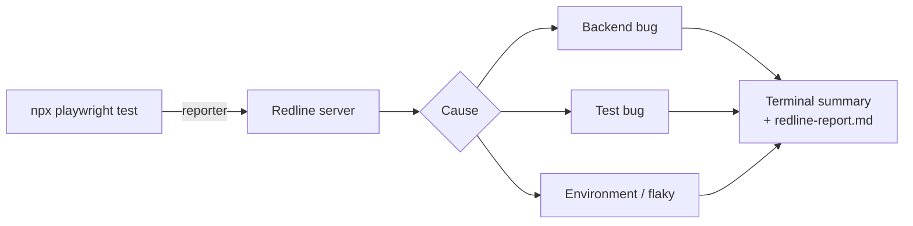

# Failure triage with Redline

[Redline](https://github.com/ega-septian/redline) classifies every failed test as a backend bug, a test bug, an environment problem or flaky, with the evidence and a curl command to reproduce it. Rules decide first; the AI is only asked when they can't.



The reporter, the fixture and the CLI come from the Redline repo as the `redline-playwright` package (`npm i -D github:ega-septian/redline#<tag>`), pinned in `package.json`.

| Command                                      | What it does                                          |
| -------------------------------------------- | ----------------------------------------------------- |
| `REDLINE_AI=1 npx playwright test`           | Run the tests and explain each failure                |
| `npm run redline:verify`                     | Prove the cause by rerunning and patching in a copy   |
| `npm run redline -- impact schemas/brand.ts` | Tests affected by a file or endpoint, with a `--grep` |
| `npm run redline -- score`                   | How often Redline's guesses turned out right          |
| `npm run redline:bench`                      | Benchmark with planted bugs (below)                   |

Without a Redline server the tests run normally. Set `REDLINE=0` to turn it off, for example in `.env` while writing tests. `REDLINE_AI=1` or `REDLINE_VERIFY=1` on the command line turn it back on for that run; whatever you type on the command line wins over `.env`. If the Redline server has an API key, put the same `REDLINE_API_KEY` in `.env` (and `REDLINE_URL` if it is not on `localhost:8787`).

In CI, Redline runs in the same job (DozerDB as a service, Redline pinned to a release) with rules only: no AI key, no cost, and no history from earlier runs.

## Benchmark

Planted bugs, Claude Haiku 5.5: new test 92–96%, test that passed before 96–100%, app upgrade 6/6, shared code 18/18. **No wrong guesses**; unsure cases are reported as "unclear". Scenarios: `--scenario=history|cold|upgrade|kag|rp`.

**Redline vs ReportPortal Auto-Analysis** (`--scenario=rp`, 24 planted bugs, both start with no history and get the right answer after each case, ReportPortal 5.15 with default settings):

|                             | Redline                        | ReportPortal Auto-Analysis              |
| --------------------------- | ------------------------------ | --------------------------------------- |
| Bug seen for the first time | 24/24                          | 2/24, 6 wrong, 16 left "To Investigate" |
| Same bug again              | 24/24 (23 from its own labels) | 21/24, 2 wrong                          |
| Backend bugs, first time    | 9/9                            | 0/9                                     |

Auto-Analysis copies labels from failures with similar logs, so it is good at repeats but labelled backend bugs as test bugs when an earlier test bug had a similar message. Caveats: one run, 24 cases, and the bugs and Redline's rules were built together, while ReportPortal ran untuned. The two are complementary: Auto-Analysis for repeats (free), Redline for new failures.

## ReportPortal (optional)

Results can also go to a local [ReportPortal](https://reportportal.io) with the official agent. It is off by default, so debug runs are not recorded:

```bash
REPORTPORTAL=1 npx playwright test
```

Needs `RP_API_KEY` in `.env` (ReportPortal → Profile → API Keys). Defaults: `RP_ENDPOINT=http://localhost:8585/api/v2`, `RP_PROJECT=superadmin_personal`, `RP_LAUNCH="Toolshop API"`. Each test's `@TC-` tag is sent as its ReportPortal test case ID (history survives renames) and as a `tc` attribute (filter with **Add filter → Attribute → `tc:TC-BRD-001`**). Skipped tests are not marked "To Investigate".

With Redline on as well, Redline fills in the cause of each failed test that is still "To Investigate" (defect type and a comment with evidence), once the launch is finished:

```bash
REDLINE=1 REPORTPORTAL=1 npx playwright test
```

Both get the same `redline_run` token per run, so Redline finds the right launch. The Redline server needs `REPORTPORTAL_URL` and its own `REPORTPORTAL_API_KEY`.
