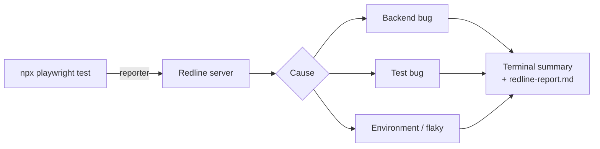

# Failure triage with Redline

[Redline](https://github.com/ega-septian/redline) classifies every failed test as a backend bug, a test bug, an environment problem or flaky, with the evidence and a curl command to reproduce it. Rules decide first; the AI is only asked when they can't.



The reporter, the fixture and the CLI come from the Redline repo as the `redline-playwright` package (`npm i -D github:ega-septian/redline#<tag>`), pinned in `package.json`.

| Command                                      | What it does                                          |
| -------------------------------------------- | ----------------------------------------------------- |
| `REDLINE_AI=1 npx playwright test`           | Run the tests and explain each failure                |
| `npm run redline:verify`                     | Prove the cause by rerunning and patching in a copy   |
| `npm run redline -- impact schemas/brand.ts` | Tests affected by a file or endpoint, with a `--grep` |
| `npm run redline -- score`                   | How often Redline's guesses turned out right          |
| `npm run redline:bench`                      | Benchmark with planted bugs (below)                   |

Without a Redline server the tests run normally. Set `REDLINE=0` to turn it off, for example in `.env` while writing tests. `REDLINE_AI=1` or `REDLINE_VERIFY=1` on the command line turn it back on for that run; whatever you type on the command line wins over `.env`. If the Redline server has an API key, put the same `REDLINE_API_KEY` in `.env` (and `REDLINE_URL` if it is not on `localhost:8787`).

In CI, pull requests run a **self-contained Redline** in the job (DozerDB as a service, Redline pinned to a release): a fresh database, the contract source seeded from the in-job Toolshop, and quarantines read from `redline-quarantine.json`. Push to `main` uses the persistent Redline when the `REDLINE_TAILNET_HOST` repository variable is set, so history, trends, artifacts and the impact graph survive across runs; see [`redline-tailscale.md`](redline-tailscale.md). The impact comment and targeted runs are advisory: on PRs they still try the persistent server over Tailscale, but an offline laptop only skips that lookup — the suite and gate run on the ephemeral server, and targeted runs fall back to the full suite. The workflow asks for AI when `REDLINE_AI=1`, but the server only calls Claude when it has an `ANTHROPIC_API_KEY`; leave the key empty on a CI-only server to stay rules-only.

Contract sources live in Redline's database. The ephemeral job seeds `toolshop` from the in-job Toolshop (`http://localhost:8091/docs`) right after the server starts, while a persistent Redline keeps the sources saved in Config across runs.

### Manual ephemeral run

Pull requests already use the ephemeral backend. A manual dispatch with `redline: ephemeral` forces the same path on a branch or on `main`, useful after a workflow change: it ignores `REDLINE_TAILNET_HOST`, starts Redline and its database inside the runner, seeds the contract, runs the suite, and applies the gate using `redline-quarantine.json`. The `redline-report` artifact contains `redline-report.md`, `redline-last-run.json` and `results.json`, so debugging does not depend on the laptop.

## PR impact (advisory)

`scripts/redline-impact.mts` maps the files changed in a pull request to tests through Redline's impact graph and updates one sticky PR comment. The full suite still runs; this is an advisory summary, not a gate.

In CI it runs on pull requests when `REDLINE_TAILNET_HOST` is set, even though the tests themselves run ephemeral; it needs a persistent Redline with history. The step is best-effort (`continue-on-error`), so an offline laptop does not block the PR and the suite falls back to full. The workflow declares `pull-requests: write` for the comment.

Local usage:

```bash
REDLINE_URL=http://localhost:8787 \
REDLINE_API_KEY=... \
node scripts/redline-impact.mts --files schemas/brand.ts,tests/api/toolshop/brand.spec.ts
```

- `--json` prints machine-readable output.
- `--base origin/main` changes the git base used when GitHub PR context is unavailable.
- `--comment` updates the PR comment marked `<!-- redline-impact -->`.
- Without GITHUB_TOKEN/GITHUB_REPOSITORY, it only prints the Markdown and writes the step summary.

Limitations: the graph comes from the last passing run per test; a file no test imports returns no tests, and a new file has no history yet. Ephemeral CI has no history, so the step is skipped. The comment includes a suggested `npx playwright test --grep "(...)"`; CI still runs the full suite until targeted runs are trusted.

### Targeted PR runs (opt-in)

Set the repository variable `REDLINE_PR_SCOPE=affected` to make pull requests run only the tests mapped by the impact graph. The workflow asks `node scripts/redline-impact.mts --grep` for a Playwright `--grep` pattern and runs that subset. If no test is mapped, the lookup fails, or the step is skipped, the full suite runs instead.

Push to `main` and the nightly/full run stay full. A manual `workflow_dispatch` can choose `scope: affected` to try it. Keep the full suite as the safety net: the graph only knows files seen in earlier runs, so a brand-new file can be missing. `--grep` prints only the pattern, which makes it usable outside Actions too.

## Quarantine and quality gate

Quarantine has two sources: Redline's Health page and `redline-quarantine.json` in this repo (quarantine as code). A quarantined test needs an owner, a reason and an expiry, and can be released before it expires. Active quarantine is keyed by the `@TC-` ID when present, so a rename keeps it.

The file is what makes an ephemeral Redline work: a fresh CI database has no quarantine history, so known failures are read from the repository instead.

```json
[
  {
    "test": "TC-BRD-019",
    "owner": "ega",
    "reason": "Flaky on the shared demo; see run #123",
    "until": "2026-12-01"
  }
]
```

Rules: `until` is `YYYY-MM-DD`, at most 90 days ahead, and an entry that has passed its date is reported as expired and ignored. Duplicate `test`, unknown fields and malformed dates fail `npm run check:quarantine` (and the gate). The file is validated in the `CI` workflow, before any test runs.

`scripts/redline-gate.mts` is the final CI decision:

- reads `test-results/redline-last-run.json`;
- fetches that run and the active quarantine list from Redline, then merges `redline-quarantine.json`;
- fails when a `failed` test has no active quarantine from either source;
- allows failures covered by the quarantine file or by a Redline UI quarantine;
- treats flaky (passed on retry) and skipped as non-blocking;
- fails closed when the report is missing, the run has report errors, or Redline cannot be reached.

The test step is `continue-on-error: true`; the gate decides the job status. Tests are not skipped: the full suite still runs, so a quarantined test that starts passing is visible immediately. Expired or released quarantine stops allowing the failure automatically.

Local run, after `npx playwright test`:

```bash
node scripts/redline-gate.mts
```

File-based quarantines are enforced by the gate and shown in its summary, but they do not appear on Redline's Health page yet: that page reads the database. Create the same quarantine in the UI when you also want it visible there.

Quarantine is for a known failure with an owner and an end date, not for hiding a new regression.

## Benchmark

Planted bugs, Claude Haiku 5.5: new test 92–96%, test that passed before 96–100%, app upgrade 6/6, shared code 18/18. **No wrong guesses**; unsure cases are reported as "unclear". Scenarios: `--scenario=history|cold|upgrade|kag|rp`.

**Redline vs ReportPortal Auto-Analysis** (`--scenario=rp`, 24 planted bugs, both start with no history and get the right answer after each case, ReportPortal 5.15 with default settings):

|                             | Redline                        | ReportPortal Auto-Analysis              |
| --------------------------- | ------------------------------ | --------------------------------------- |
| Bug seen for the first time | 24/24                          | 2/24, 6 wrong, 16 left "To Investigate" |
| Same bug again              | 24/24 (23 from its own labels) | 21/24, 2 wrong                          |
| Backend bugs, first time    | 9/9                            | 0/9                                     |

Auto-Analysis copies labels from failures with similar logs, so it is good at repeats but labelled backend bugs as test bugs when an earlier test bug had a similar message. Caveats: one run, 24 cases, and the bugs and Redline's rules were built together, while ReportPortal ran untuned. The two are complementary: Auto-Analysis for repeats (free), Redline for new failures.

## ReportPortal (optional)

Results can also go to a local [ReportPortal](https://reportportal.io) with the official agent. It is off by default, so debug runs are not recorded:

```bash
REPORTPORTAL=1 npx playwright test
```

Needs `RP_API_KEY` in `.env` (ReportPortal → Profile → API Keys). Defaults: `RP_ENDPOINT=http://localhost:8585/api/v2`, `RP_PROJECT=superadmin_personal`, `RP_LAUNCH="Toolshop API"`. Each test's `@TC-` tag is sent as its ReportPortal test case ID (history survives renames) and as a `tc` attribute (filter with **Add filter → Attribute → `tc:TC-BRD-001`**). Skipped tests are not marked "To Investigate".

With Redline on as well, Redline fills in the cause of each failed test that is still "To Investigate" (defect type and a comment with evidence), once the launch is finished:

```bash
REDLINE=1 REPORTPORTAL=1 npx playwright test
```

Both get the same `redline_run` token per run, so Redline finds the right launch. The Redline server needs `REPORTPORTAL_URL` and its own `REPORTPORTAL_API_KEY`.
